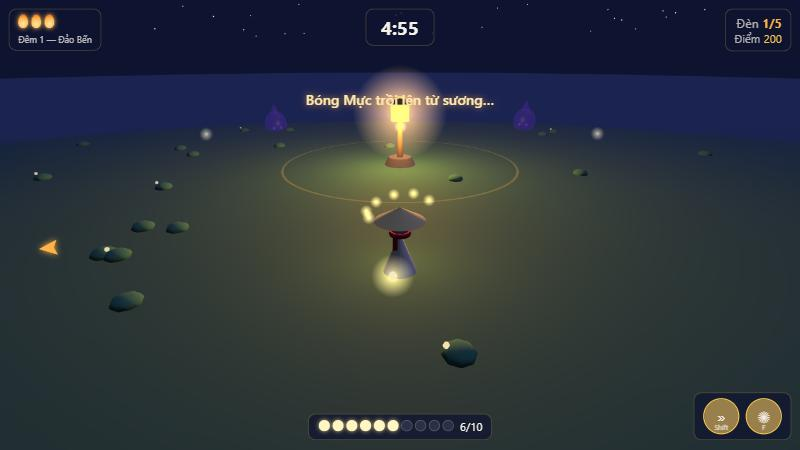

# Đảo Đèn Lồng

> **Video demo:** _(có ở Phase 4, Release `v1.0.0`)_ · **Bằng chứng:** [Phase 1](docs/proof/phase-1/README.md) · [Phase 2](docs/proof/phase-2/README.md) · Đề lab: [docs/lab](docs/lab/README.md)

Game 3D góc nhìn thứ ba (Day 12 · AI SDLC Lab). Bạn là **Mây**, người giữ đèn nhỏ tuổi đội nón lá treo đèn lồng. Qua **ba Đêm trên ba hòn đảo**, gom đom đóm, nạp ánh sáng để thắp lại các **Đèn Lồng Lớn** trước bình minh, tỏa sáng để xua **Bóng Mực** và giữ đom đóm khỏi **Gió Lạc**.



Tác giả: Nguyễn Đắc Tuấn Nghĩa · 2A202603442 · K5-L3A.

## Cài đặt và chạy (cần Node.js ≥ 18; macOS / Linux / Windows)

```bash
git clone <repo-url> && cd K5-L3A-DAY12-NguyenDacTuanNghia-2A202603442-AI-SDLC-Dao-Den-Long
npm install
npm start          # mở http://localhost:8080
```

## Điều khiển

| Phím | Hành động |
|---|---|
| W A S D / phím mũi tên | Di chuyển (theo hướng camera) |
| Kéo chuột trái / J, L | Xoay camera (độ nhạy chỉnh trong Cài đặt) |
| Space | Nhảy |
| Shift | Lướt (14 m/s trong 0.2 s, hồi chiêu 1.5 s) |
| E | Nạp ánh sáng vào đèn (đứng trong 2 m) |
| F / chuột phải | Tỏa Sáng: tốn 3 đom đóm, choáng + đẩy Bóng Mực trong 5 m |
| Esc / P | Tạm dừng (Tiếp tục · Chơi lại Đêm · Cài đặt · Về menu) · M: tắt/bật âm thanh |

Thêm `?seed=123` vào URL để chơi lại đúng một màn.

## Ba Đêm

| Đêm | Đảo | Đèn | Thời gian | Điểm mới |
|---|---|---|---|---|
| 1 | Đảo Bến — đảo tròn 40 m | 5 | 5:00 | — |
| 2 | Đảo Cau — hai đảo nối bằng cầu tre, bục nhảy | 6 | 5:30 | Gió Lạc, Bùa Gió |
| 3 | Đảo Chuông — ba tầng, dốc, tháp chuông, gió mạnh | 7 | 6:00 | Gió thổi 5 s mỗi 30 s |

Thắng Đêm 3 để thấy **Bình Minh** với tổng điểm. Thua thì chơi lại Đêm đó.

## Luật và cách tính điểm

- Mang tối đa **10** đom đóm. Mỗi đèn cần **10** (nạp nhiều lần được). Thắp hết đèn của Đêm → **thắng**.
- Có **3 Ngọn Lửa** (hồi đầy mỗi Đêm). Bóng Mực chạm → mất 1 lửa, rơi một nửa số đom đóm ra quanh Mây (nhặt lại được trong 8 s), bất tử 1.5 s. Rơi khỏi đảo → mất 1 lửa và toàn bộ đom đóm. Hết lửa → **thua**. Hết giờ → bình minh → **thua**.
- Bóng Mực không vào được vòng **6 m** quanh đèn đã sáng. **Gió Lạc** cướp tối đa 3 đom đóm khi bạn mang từ 5 con trở lên. **Bùa Gió** cho chạy nhanh và lướt không hồi chiêu trong 10 s.

| Sự kiện | Điểm |
|---|---|
| Mỗi đom đóm **nạp** vào đèn | +10 |
| Thắp một đèn | +100 |
| Mỗi Bóng Mực trúng Tỏa Sáng | +5 |
| Khi thắng: mỗi giây còn lại (làm tròn xuống) | +2 |
| Khi thắng: mỗi Ngọn Lửa còn lại | +50 |

Tổng điểm game là tổng điểm các Đêm đã thắng.

## Test Contract (headless, v1.1)

`game.contract.json` ở gốc repo khai báo lệnh và mọi số tuning (bằng đúng số chuẩn Ticket-02). Chạy headless:

```bash
node src/headless.js --seed 1 --night 2 [--scenario s.json] [--inputs i.json] --ticks 600 --out out.jsonl [--snapshot-every 10]
```

Exit 0 khi chạy xong; **2** khi file inputs/scenario sai định dạng; 1 cho lỗi khác (ví dụ `--night 4`). Ghi chú triển khai contract: [docs/notes/contract-v1.md](docs/notes/contract-v1.md). Giả định: [Phase 1](docs/notes/phase-1.md#3-giả-định-cho-chỗ-prd-0-còn-mơ-hồ), [Phase 2](docs/notes/phase-2.md#3-giả-định-cho-chỗ-ticket-chưa-nói-rõ).

## Kiểm thử

```bash
npm test           # contract + CLI + 47 scenario qua CLI thật + tất định + phát lại ván chơi trọn
npm run proof      # sinh lại docs/proof/<phase>/headless-report.md
node scripts/bot.js --seed 3 --night 1 --out inputs.json   # bot tự chơi, ghi file inputs
```

CI (GitHub Actions) chạy `npm test` trên Ubuntu và macOS mỗi lần push.

## Sáng tạo của tôi

Tất cả chỉ nằm ở `src/web/` (phần hiển thị), không có trong headless nên **không đổi đầu ra contract** — bằng chứng: toàn bộ scenario và kiểm tra tất định chạy trên `src/sim/` vẫn xanh, và `src/sim/` không import gì từ `src/web/`.

- **Cú Tí** — chú cú nhỏ bay theo Mây; khi Mây đang mang ánh sáng, Cú Tí bay tới lượn trên **đèn chưa sáng gần nhất** và kêu "hú hú" để chỉ đường.
- **Đom đóm bay quanh nón lá** — số đốm sáng xoay quanh nón đúng bằng số đom đóm đang mang.
- **Ông Đăng** — người giữ đèn già giới thiệu từng Đêm.
- **Âm thanh tự tổng hợp** bằng WebAudio (không dùng file): nhạc nền ngũ cung, tiếng nhặt cao dần, hợp âm thắp đèn, gió, tiếng đếm ngược.
- **Lá bay** báo trước cơn gió ở Đêm 3; Bóng Mực "trồi lên" từ sương khi sinh ra.

## Cấu trúc

```text
src/sim/        luật chơi thuần, tất định (dùng chung) — tuning.js số liệu, levels.js 3 bản đồ chuẩn
src/headless.js CLI theo Test Contract v1.1
src/web/        bản 3D Three.js (main.js luồng game + HUD, world.js mô hình, audio.js âm thanh)
tests/          node:test — scenarios.js là danh sách scenario có ID yêu cầu
scripts/        serve.js (server tĩnh), bot.js (tự chơi), proof.js (sinh bằng chứng), hooks/
docs/notes/     giả định, tiêu chí nghiệm thu, nhật ký AI · docs/proof/ bằng chứng từng phase · docs/lab/ đề bài + ticket
AGENTS.md, CLAUDE.md, .claude/ (hook, skill, agent)   harness AI
```

Giấy phép: [MIT](LICENSE) · Nguồn và công cụ: [CREDITS.md](CREDITS.md) · Thay đổi: [CHANGELOG.md](CHANGELOG.md)
